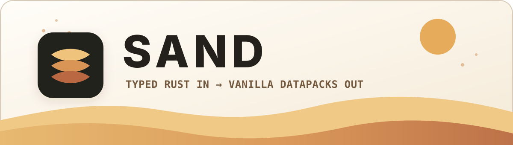

<div align="center">
  <picture>
    <source media="(prefers-color-scheme: dark)" srcset="assets/readme/sand-header-dark.svg">
    <source media="(prefers-color-scheme: light)" srcset="assets/readme/sand-header-light.svg">
    
  </picture>
</div>

<p align="center">
  <strong>A strongly typed Rust framework for building vanilla Minecraft Java datapacks.</strong>
</p>

<p align="center">
  <a href="https://github.com/ThatOneToast/sand/actions/workflows/rust.yml"></a>
  <a href="#minecraft-versions"></a>
  <a href="#stability"></a>
  <a href="LICENSE"></a>
</p>

<p align="center">
  <a href="#why-sand">Why Sand</a> ·
  <a href="#quick-start">Quick start</a> ·
  <a href="#what-you-can-build">Features</a> ·
  <a href="book/src/introduction.md">Guide</a> ·
  <a href="examples/README.md">Examples</a> ·
  <a href="ROADMAP.md">Roadmap</a>
</p>

## Why Sand?

Datapacks are a great **distribution format**: portable, server-native, and
made from ordinary files that Minecraft already understands. At scale, they
become a cumbersome **authoring format**: command strings, JSON resources,
scoreboard conventions, version differences, and cross-file wiring all have to
stay in sync by hand.

Sand moves that work into Rust. You author against typed commands, state,
conditions, resource identifiers, and version profiles; Sand exports a normal
datapack under `data/<namespace>/...`.

**Typed Rust in. Vanilla datapacks out. No mod required.**

```rust
use sand::prelude::*;

#[derive(State)]
#[state(namespace = "oasis", scope = player)]
struct PlayerState {
    #[state(
        default = 0,
        min = 0,
        max = 100,
        display_name = "Discoveries"
    )]
    discoveries: Score,
}

#[function]
pub fn discover_oasis() {
    let state = PlayerState::on(EntityContext::<PlayerKind>::default());
    state.discoveries.add(1);
    cmd::tellraw(
        Target::self_(),
        Text::new("Oasis discovered!").gold().bold(true),
    );
}
```

`#[derive(State)]` provisions and initializes the objective automatically.
The generated `PlayerStateBound` exposes `discoveries` as an ordinary typed
field, and `#[function]` exports `discover_oasis` as a callable function. The
result is still the vanilla format you would ship without Sand:

Automatic provisioning, custom score criteria/display names, and `auto_tick`
apply to every supported scope. Entity and living components are initialized
through explicit attachment or an archetype adoption policy and tick only
while eligible owners are loaded. `StateBundle` composes independently
versioned components, `StateQuery` filters their runtime presence, and
`#[system]` connects typed tick or event behavior to the existing scheduler and
event dispatcher. See the [unified State tutorial](examples/unified_state/README.md).

```text
dist/oasis/
├── pack.mcmeta
└── data/
    ├── minecraft/tags/function/load.json
    └── oasis/function/
        ├── __sand_lifecycle_load.mcfunction
        └── discover_oasis.mcfunction
```

```mcfunction
# data/oasis/function/discover_oasis.mcfunction
scoreboard players add @s <deterministic-objective> 1
tellraw @s {"bold":true,"color":"gold","text":"Oasis discovered!"}
```

Keep the generated files, inspect them, zip them, or copy them directly into a
world's `datapacks/` directory. Sand is an authoring tool and build pipeline,
not a runtime dependency.

## What you can build

### Framework

- **Attribute-first packs** — export functions and lifecycle hooks with
  `#[function]`, `#[datapack_component(Load)]`, and `#[datapack_component(Tick)]`.
- **Typed commands and control flow** — selectors, text, execute chains,
  conditions, particles, sounds, scoreboards, NBT operations, and generated
  command builders.
- **Typed state** — `#[derive(State)]` generates scoped, autocomplete-friendly
  bound views for scores, flags, timers, cooldowns, finite enums, marker
  components, and global typed-data resources; bundles and queries retain named
  fields throughout composition.
- **Data-driven resources** — builders for recipes, advancements, predicates,
  loot tables, item modifiers, tags, dialogs, enchantments, and more.
  Coverage varies by resource; explicit raw JSON, SNBT, component, and command
  escape hatches remain available for unsupported edges.
- **Structure-template assets** — validate and copy existing `.nbt` files into
  `data/<namespace>/structure/`. Sand does not parse, generate, or semantically
  validate their binary NBT payloads. The component audit tracks these
  non-registry assets separately from registries and tags.
- **Version-aware output** — exact 26.x profiles describe verified schema
  differences and generated registries fail safely for unknown future targets.

### Gameplay systems

`sand::systems` builds on the same State, entity and lifecycle models:

- **Owned work** — `Lifetime`, abilities, status effects, projectiles, child tasks,
  condition waits and joins with bounded work and explicit cleanup.
- **Encounters and presentation** — combat policies, priority-based encounter
  controllers, sequences, block/item/text scenes, owned HUDs and batched jobs.
- **Progression** — canonical-State objectives and rewards, plus owned sessions
  with explicit reset/restart, saved-phase resume and checked checkpoint projections.
- **Interactions** — paginated player menus, exact object-bound sessions,
  typed conversation views, clickable hitboxes, guarded item payments, whole-stack
  transfers and refreshable State-driven journal books.

These are alpha systems with explicit vanilla limits: collision is sampled,
encounters do not provide pathfinding, books are snapshots, and menus do not
intercept chest-slot clicks. Start with the [gameplay guides](book/src/23d-owned-gameplay.md)
and [interaction example](examples/interaction_hub/). The [roadmap](ROADMAP.md)
separates implemented behavior, remaining systems and validation gaps.

### CLI

- `sand new` and `sand init` scaffold an attribute-first project.
- `sand build` compiles deterministic output into `dist/`; `--release` also
  creates a distributable zip.
- `sand run` builds the pack, prepares a local Minecraft server, and presents
  classified, verbose, raw, or JSON server logs.
- `sand add worldbuild` adds typed world/server configuration.
- `sand add resourcepack` opts in to a [companion client asset pack](book/src/17a-companion-resource-packs.md),
  built separately under `dist/<namespace>-resources/`.
- `sand join` integrates with Prism Launcher for local testing.
- `sand clean` removes generated pack and optional server/build artifacts.

Run `sand --help` for the complete command reference.

## Quick start

Sand is not published to crates.io yet. Install the CLI from a clone:

```sh
git clone https://github.com/ThatOneToast/sand.git
cd sand
cargo install --path sand-cli
```

Then scaffold and build a pack:

```sh
sand new oasis --mc-version 26.3
cd oasis
sand build
```

The scaffold uses the `sand` façade crate for authoring and `sand-build` for
export:

```toml
[dependencies]
sand = { git = "https://github.com/ThatOneToast/sand.git", branch = "main" }

[build-dependencies]
sand-build = { git = "https://github.com/ThatOneToast/sand.git", branch = "main" }
```

Because `main` moves quickly, pin both dependencies to the same Git revision
when you need a reproducible project.

Coding agents can discover that resolved project identity and query the exact
installed API contract surface without scraping terminal prose:

```sh
sand context --format json
sand api search "player damage" --format json
sand api alternatives "damage entity" --format json
sand build --format json
sand check --agent --format json
```

See [CLI For Coding Agents](book/src/reference/agent-cli.md) for compatibility
rules, structured search controls, and the recommended validation loop.

## Minecraft versions

- Sand targets **Minecraft Java 26.x and newer**. Versions below 26 are rejected.
- **26.3** is the default export and generated-API target. Exact 26.1 and 26.2
  profiles remain available; version-specific capability limits are documented
  in the version support reference.
- Later calendar versions can be represented, but unknown schemas use
  conservative capabilities. Use `VersionProfile::resolve_strict()` when exact
  Minecraft data is required.

Minecraft Java version support is profile-aware rather than a promise that
every resource field or advancement trigger has identical typed coverage.
Consult the [version support reference](book/src/reference/version-support.md)
and resource-specific API documentation when targeting an edge case.

## Stability

> [!IMPORTANT]
> **Sand is alpha software.** The public API can change between commits, and
> removed APIs do not receive compatibility shims. Pin a known-good Git
> revision for projects that need stability.

The attribute-first authoring model, typed state and conditions, typed text and
execute chains, command builders, and scaffolding are the firmest parts of the
project today. Events, dialogs and the owned gameplay systems are alpha.
`mcfunction!` and registry coverage for unreleased Minecraft versions are
experimental.

Sand produces vanilla files, but successful Rust compilation alone does not
prove that every gameplay path behaves as intended. Inspect generated output
and test serious packs with a vanilla server before release.

## Learn and contribute

- [Sand Guide](book/src/introduction.md) — installation, authoring, debugging,
  packaging, and reference material.
- [Trailforge example](examples/book_project/src/lib.rs) — a complete pack with
  state, items, recipes, events, dialogs, conditions, and effects.
- [Examples index](examples/README.md) — focused examples and standalone pack
  projects.
- [Architecture](docs/architecture/adr-001-crate-boundaries.md) — public
  façade, implementation crates, and dependency boundaries.
- [Contributing](CONTRIBUTING.md) — toolchain policy and validation commands.

Sand is available under the [MIT License](LICENSE).

<sub>Sand is an independent project and is not affiliated with or endorsed by
Mojang Studios or Microsoft.</sub>
